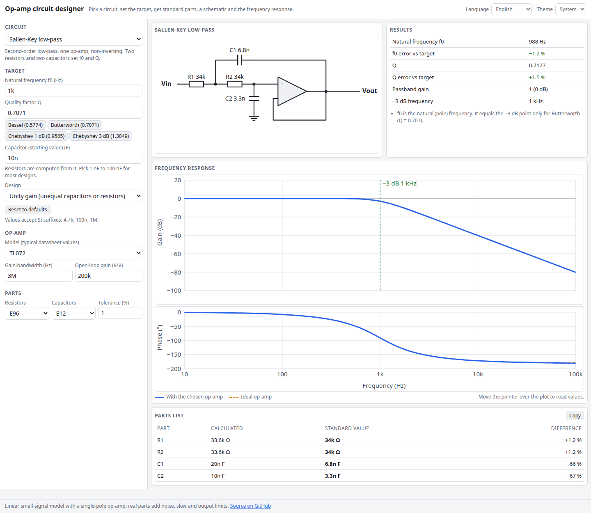

# Op-amp Circuit Designer

Pick an op-amp circuit, type the gain, cutoff or threshold you want, and get standard E-series resistor and capacitor values, a schematic, a results table and a frequency response that includes your op-amp's gain-bandwidth limit. Everything runs in your browser.

**Try it: [hermes98761234.github.io/opamp-circuit-designer](https://hermes98761234.github.io/opamp-circuit-designer/)**

[](https://github.com/hermes98761234/opamp-circuit-designer/actions/workflows/deploy.yml)



## Features

- **Eleven circuits.** Inverting, non-inverting, difference, instrumentation (three op-amps) and summing amplifiers, an integrator with a DC-gain limit, Sallen-Key low-pass and high-pass, multiple-feedback (Rauch) low-pass and band-pass, and a Schmitt trigger (comparator with hysteresis).
- **Real parts.** Resistors from E6 to E192 and capacitors from E6 to E192. For gain-setting pairs and capacitor ratios it searches for the combination with the smallest error, not just the nearest value of each.
- **GBW-aware response.** Magnitude and phase plots show the chosen op-amp (finite gain and gain-bandwidth) against an ideal one, with the -3 dB point marked. Presets for common op-amps (LM358, TL072, NE5532, OPA1612 and more), or enter your own GBW and open-loop gain.
- **Honest numbers.** Results show the achieved gain, f0 and Q against the target, the worst-case gain error for your resistor tolerance, closed-loop bandwidth, CMRR from resistor tolerance, Schmitt thresholds and more, with warnings when the op-amp is too slow for the design.
- **Schematic** drawn as SVG for every circuit, with the standard values on it, and a copyable parts list.
- **English or Ukrainian, light, dark or system theme.** Settings and each circuit's inputs are remembered in the browser. Values accept SI suffixes (`4.7k`, `100n`).
- **No backend.** Nothing is uploaded and nothing is tracked.

## How it works

Every response curve comes from a real circuit simulation. The design code builds a netlist of resistors, capacitors and op-amps and solves it with complex modified nodal analysis at each frequency. The op-amp is a voltage-controlled source with a single-pole gain `A(s) = A0 / (1 + s / (2π · GBW / A0))`. The dashed curve uses a practically ideal op-amp, the solid one your chosen part.

Closed-form formulas pick the component values, and they are also used to report the f0 and Q the standard values really give:

- Sallen-Key: `ω0 = 1/√(R1R2C1C2)`, `1/Q = ω0 [C2(R1+R2) + R1C1(1−K)]` (low-pass), and the dual for high-pass.
- Multiple feedback: low-pass `ω0 = 1/√(R2R3C1C2)`; band-pass `Q = π f0 R3 C`, gain at f0 `R3/(2R1)`, `R2 = R3/(4Q² − 2A0)`.
- Schmitt trigger: thresholds `Vref + (Vout − Vref) · R2/(R1+R2)` at each output rail.

The unit tests check the solver against RC and inverting-amplifier textbook results, check the closed-form filter formulas against the simulated peaks and corners, and check the E-series tables against IEC 60063.

Limits: the model is linear and small-signal. It does not include slew rate, input offset, noise, output swing or capacitor and resistor parasitics. The Schmitt trigger assumes the output reaches the levels you enter.

## Quick start

You need [Node.js](https://nodejs.org/) 22.

```bash
git clone https://github.com/hermes98761234/opamp-circuit-designer.git
cd opamp-circuit-designer
npm install
npm run dev       # http://localhost:5173
npm test          # solver, design, E-series and i18n tests
npm run build     # static site in dist/
```

## License

MIT
